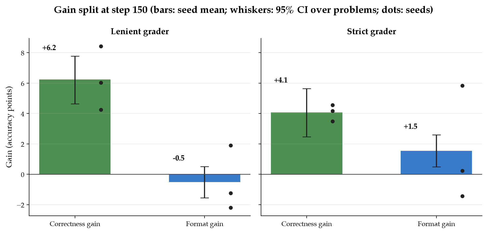
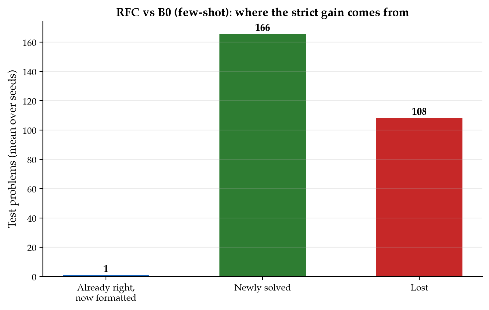
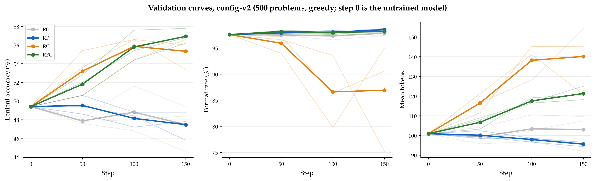
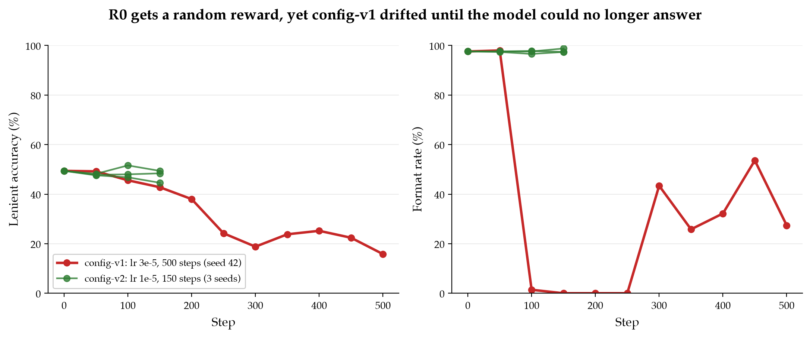

# Results: config-v2

GSM8K test set (1,319 problems), greedy decoding. Every trained model is the step-150 adapter
(fixed by the stability gate, METHODOLOGY §13). Cells are averaged over seeds 42 / 43 / 44.
B0 is the base model with the trained (few-shot) prompt.

## Results

| Model | Lenient % [95% CI] | Strict % [95% CI] | Lenient per seed | Format % | Mean tokens | Truncated % |
|---|---|---|---|---|---|---|
| B0, zero-shot prompt | 6.4 [5.1, 7.7] | 3.9 [3.0, 5.1] | – | 91.2 | 31 | 1.0 |
| B0, few-shot prompt (trained) | 38.8 [36.2, 41.5] | 38.7 [36.1, 41.3] | – | 96.8 | 111 | 1.9 |
| R0 | 37.6 [35.3, 40.0] | 37.5 [35.2, 39.8] | 34.5 / 37.8 / 40.5 | 97.2 | 111 | 1.7 |
| RF | 38.0 [35.6, 40.5] | 37.9 [35.4, 40.4] | 37.7 / 37.8 / 38.5 | 98.0 | 105 | 1.5 |
| RC | 44.8 [42.4, 47.1] | 40.4 [38.2, 42.7] | 44.2 / 45.1 / 45.0 | 84.9 | 154 | 2.6 |
| RFC | 43.3 [41.0, 45.7] | 43.1 [40.8, 45.5] | 44.8 / 42.6 / 42.5 | 97.2 | 132 | 2.0 |

Intervals: 95% paired bootstrap over test problems (10,000 resamples), after averaging
seeds; they do not include seed-to-seed variation, which the per-seed column shows.

**What prompting alone buys:** the few-shot prompt raises lenient accuracy from
6.4% to 38.8% with no training.

## Gain split (points)

| Quantity (points) | Lenient [95% CI] | Lenient per seed | Strict [95% CI] | Strict per seed |
|---|---|---|---|---|
| Correctness gain | 6.2 [4.6, 7.8] | 8.4 / 6.0 / 4.2 | 4.1 [2.5, 5.6] | 4.2 / 4.5 / 3.5 |
|   RC − R0 | 7.2 [5.4, 8.9] | 9.7 / 7.3 / 4.5 | 3.0 [1.1, 4.7] | 1.4 / 4.2 / 3.2 |
|   RFC − RF | 5.3 [3.4, 7.2] | 7.1 / 4.8 / 4.0 | 5.2 [3.2, 7.1] | 6.9 / 4.9 / 3.8 |
| Format gain | -0.5 [-1.6, 0.5] | 1.9 / -1.3 / -2.2 | 1.5 [0.5, 2.6] | 5.8 / 0.2 / -1.4 |
|   RF − R0 | 0.4 [-1.0, 1.8] | 3.2 / 0.0 / -2.0 | 0.4 [-1.0, 1.8] | 3.1 / -0.1 / -1.7 |
|   RFC − RC | -1.4 [-2.9, 0.0] | 0.6 / -2.5 / -2.4 | 2.7 [1.1, 4.1] | 8.6 / 0.5 / -1.1 |
| Total (RFC − R0) | 5.7 [4.0, 7.4] | 10.3 / 4.8 / 2.0 | 5.6 [3.9, 7.3] | 10.0 / 4.8 / 2.0 |
| R0 − B0 (no-signal drift) | -1.2 [-2.7, 0.2] | -4.3 / -1.0 / 1.7 | -1.2 [-2.7, 0.3] | -4.2 / -0.9 / 1.6 |

Correctness claims use the lenient grader; the benchmark view and the format claim use the strict
grader (METHODOLOGY §9). Per-seed values are listed in seed order 42 / 43 / 44.



**Format headroom.** With the few-shot prompt the base model already uses the required format in
96.8% of completions, and 0.2% of problems have the right
number outside the FINAL line, which is all a format reward could fix.

## Where the strict gain comes from (RFC vs B0)

| Seed | Already right, now formatted | Newly solved | Lost | Net strict gain |
|---|---|---|---|---|
| 42 | 1 | 184 | 109 | 76 |
| 43 | 1 | 159 | 109 | 51 |
| 44 | 1 | 154 | 107 | 48 |

The net gain hides a lot of churn: RFC newly solves many problems B0 missed, but also loses many that
B0 had. Almost none of the gain is a right answer that was only missing the FINAL line.



## Training



| Cell | Seconds / step | Training hours per run (no validation) | Peak VRAM (GB) | Steps skipped % |
|---|---|---|---|---|
| R0 | 9.0 | 0.38 | 4.8 | 0.2 |
| RF | 7.5 | 0.31 | 4.8 | 70.9 |
| RC | 10.6 | 0.44 | 4.8 | 8.7 |
| RFC | 9.2 | 0.39 | 4.8 | 4.9 |

## A stability lesson: config-v1

config-v1 (learning rate 3e-5, 500 steps) degraded in every cell. Its test set was evaluated once,
before the change; config-v2 used none of these numbers.

| Model | Lenient % | Strict % | Format % | Truncated % |
|---|---|---|---|---|
| B0, few-shot | 38.8 | 38.7 | 96.8 | 1.9 |
| R0 | 12.5 | 6.1 | 32.0 | 40.6 |
| RF | 25.0 | 25.0 | 99.5 | 0.5 |
| RC | 9.9 | 3.1 | 6.5 | 84.0 |
| RFC | 1.4 | 1.4 | 100.0 | 0.0 |



## Hand-checks of the lenient grader

A person judged each completion blind (the grader's decision hidden) and the result was compared with the
lenient grader. The targeted slice is picked from the hard cases on purpose, so it is reported apart from
the uniform samples. Samples this small bound the error rate only loosely; they cannot rule out rare misreads.

| Sample | Agree | Rate |
|---|---|---|
| B0, few-shot, before training (validation) | 50 / 50 | 100% |
| RC, step 150, uniform (test) | 25 / 25 | 100% |
| RFC, step 150, uniform (test) | 25 / 25 | 100% |
| RC without FINAL line, targeted slice (test) | 20 / 20 | 100% |

## Example problem

Chosen by a fixed rule: the first test problem that B0 gets strict-wrong and RFC (seed 42)
gets strict-right.

Problem `test-00016`, gold answer **230**, seed 42.

**B0** (format 0, strict 0, lenient 0)

```text
The distance covered by the first train in the two days is 80 miles.
The distance covered by the second train in the two days is 150 miles.
FINAL: 80, 150
```

**R0** (format 0, strict 0, lenient 0)

```text
The distance covered by the first train in the two days is 80 miles.
The distance covered by the second train in the two days is 150 miles.
FINAL: 80, 150
```

**RF** (format 1, strict 1, lenient 1)

```text
The first train traveled 80 miles in the first day, so it covered 80 miles.
The second train traveled 150 miles in the second day, so it covered 150 miles.
Therefore, the distance covered by each train in the two days is 80 + 150 = 230 miles.
FINAL: 230
```

**RC** (format 0, strict 0, lenient 0)

```text
Let's denote the distance covered by the first train as \( D_1 \) and the distance covered by the second train as \( D_2 \). We know that \( D_1 = 80 \) miles and \( D_2 = 150 \) miles.

Since both trains travel for the same amount of time, we can set up the following equation based on the time each train takes to travel 80 miles:

\[ \text{Time} = \frac{\text{Distance}}{\text{Speed}} \]

For the first train:
\[ \text{Time}_1 = \frac{80 \text{ miles}}{\text{Speed}_1} \]

For the second train:
\[ \text{Time}_2 = \frac{150 \text{ miles}}{\text{Speed}_2} \]

Since the time taken by both trains is the same, we can set the two times equal to each other:

\[ \frac{80}{\text{Speed}_1} = \frac{150}{\text{Speed}_2} \]

We can solve for the speed of each train by cross-multiplying:

\[ 80 \times \text{Speed}_2 = 150 \times \text{Speed}_1 \]

\[ \text{Speed}_1 = \frac{80 \times \text{Speed}_2}{150} \]

Now, we can find the distance covered by each train in the two days by multiplying the speed of each train by the number of days (2 days):

\[ D_1 = \text{Speed}_1 \times 2 \]
\[ D_2 = \text{Speed}_2 \times 2 \]

Substituting the expression for the speed of each train:

\[ D_1 = \frac{80 \times \text{Speed}_2}{150} \times 2 \]
\[ D_2 = \text{Speed}_2 \times 2 \]

Since we don't have the specific values for the speed of each train, we can't calculate the exact distances. However, we can express the distances in terms of the speed of each train.

If we assume that the speed of each train is the same, we can say that the distance covered by each train in the two days is:

\[ D_1 = \frac{80 \times \text{Speed}_2}{1
```

**RFC** (format 1, strict 1, lenient 1)

```text
The first train travels 80 miles westward, so it covers 80 miles.
The second train travels 150 miles northward, so it covers 150 miles.
The total distance covered by both trains in the two days is 80 + 150 = 230 miles.
FINAL: 230
```
